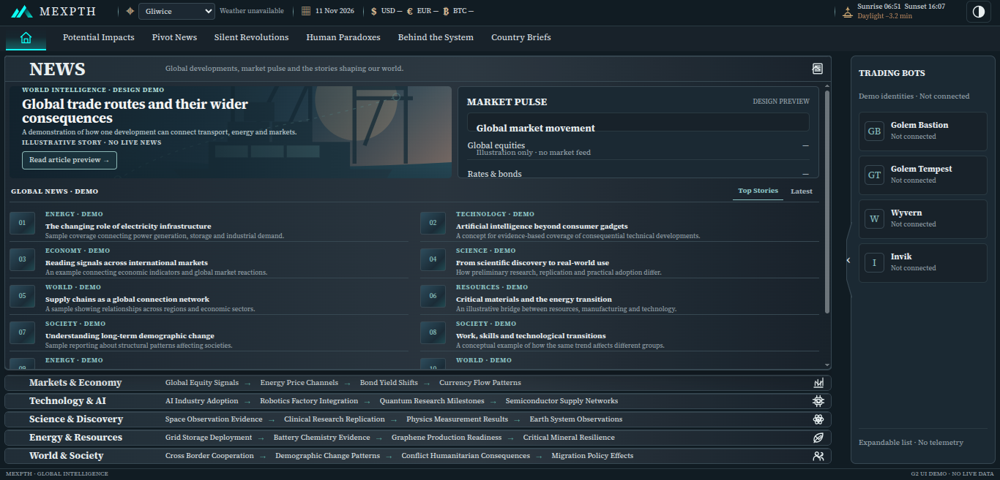
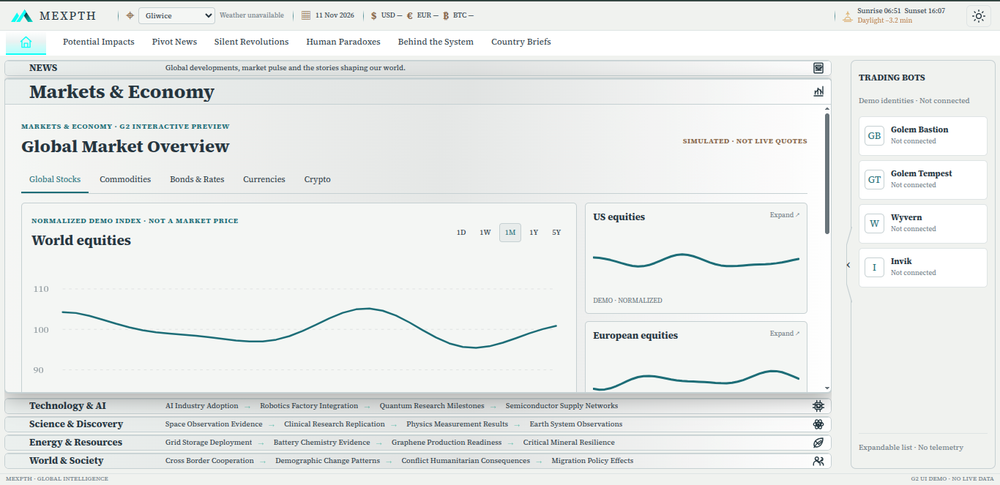
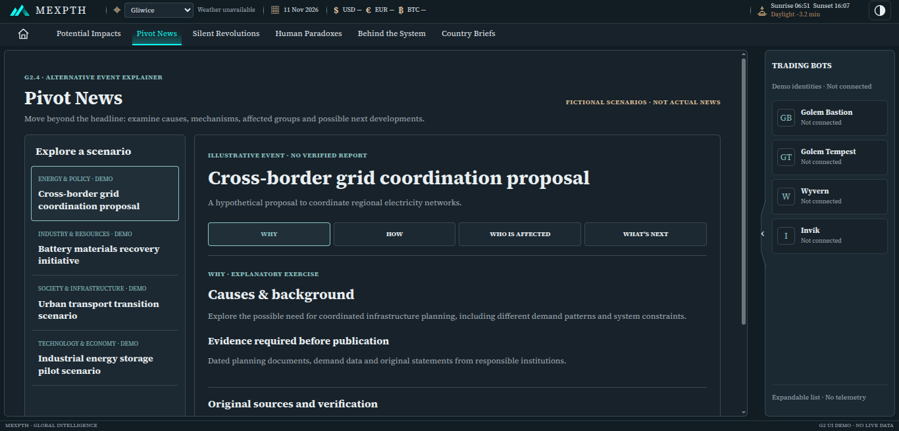
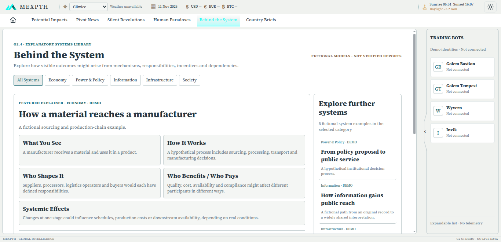

# MEXPTH

**Global events, emerging trends and their potential impact on the future.**

**Status:** Local prototype — in development (G2 interface stage; formal overall G2 acceptance pending)
**Availability:** Private local preview only; not a live public news service
**Source code:** Not publicly distributed

MEXPTH is a KingVMai portfolio project exploring how significant world events and developments in technology, science, energy and markets can be presented in a consistent analytical interface. Rather than browsing disconnected subjects, users are intended to explore related topics and understand why an event might matter.

## The problem and approach

Important developments are often scattered across different news categories, making their context and possible consequences difficult to follow. MEXPTH aims to connect global coverage, thematic exploration and cross-domain perspectives in one navigable interface. The current build demonstrates the user experience with **illustrative, synthetic information**, not production news feeds.

## What the local prototype demonstrates

- A HOME/NEWS dashboard with five interactive thematic panels: **Markets & Economy**, **Technology & AI**, **Science & Discovery**, **Energy & Resources**, and **World & Society**.
- Six alternative editorial perspectives: **Potential Impacts**, **Pivot News**, **Silent Revolutions**, **Human Paradoxes**, **Behind the System**, and **Country Briefs**. Potential Impacts includes interactive navigation among related topics.
- A fixed responsive WebApp layout with dark, light and system themes, plus a demonstrative expandable **Trading Bots** rail. Bot execution and real integrations are not available through this prototype.

## Verified progress

- **G0 and G1:** Owner-approved project definition and local application foundation.
- **G2:** Active. The five thematic panels passed their specialized technical checks (5/5); six editorial tab interfaces were integrated locally.
- Integrated desktop/tablet/mobile navigation regression: **90 assertions passed** (3 November 2026).
- Latest reported browser checks across dark/light/system themes at 390px and 1600px: **6/6 passed** (8 November 2026).
- Local production build and lint checks passed; HTTP 200 was verified for the local preview (10 November 2026).

These results are internal project checks, not independent certification. Formal owner acceptance of the entire G2 stage remains pending.

## Screenshots — actual local prototype

The images below are screenshots of the local prototype, with embedded image metadata removed from the public copies. They demonstrate visual layout, not live content ingestion.

### Main interface

| Dark theme | Light theme |
| --- | --- |
|  |  |

### Additional interface views

| Dark theme | Light theme |
| --- | --- |
|  |  |

Open any image in the repository to inspect it at full resolution. No video demonstrations are provided.

## My contribution and how AI was used

**My role — product direction, requirements and verification.** I defined the project concept, editorial priorities, functional requirements and visual direction. I coordinated AI-executed tasks, reviewed interfaces and test evidence, requested corrections, approved specific design decisions and controlled scope and project gates.

**AI's role — technical implementation.** AI-assisted workflows produced and modified the application code, interface assets, project documentation and technical checks under my direction. I do **not** claim to have personally programmed the application. This project demonstrates requirements definition, AI orchestration, iterative validation and product ownership.

## Technology overview

The private implementation uses **Next.js 16, React 19, TypeScript, CSS/SVG and browser-based QA tooling**. No implementation source, internal roadmap, logs or credentials are included in this public portfolio.

## What is not yet implemented

- Automated ingestion and validation of actual news or live market information.
- Public deployment of the MEXPTH information portal.
- Authenticated private owner console, real bot API integrations or trading controls.
- Independently tested disaster recovery from the private source repository.

For verified milestones and limitations, see [Validation](docs/VALIDATION.md).

---
**KingVMai · MEXPTH portfolio showcase · November 2026**
*This is a public project case study, not an open-source application or a live service.*
